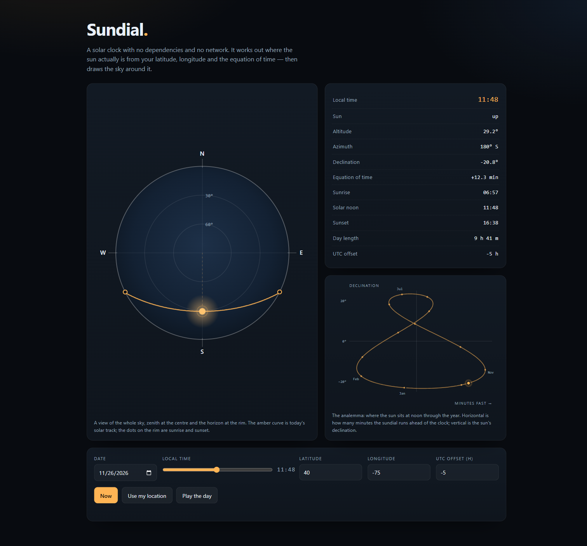

# Sundial

A solar clock with no dependencies and no network. Give it a latitude, a
longitude and a time, and it draws where the sun really is — not where the
clock says it should be.

**[Open it live →](https://dvvagram.github.io/sundial/)**



## What it shows

- **A sky chart.** The whole sky as a polar map: zenith at the centre, horizon
  at the rim, north up. The amber arc is the sun's track for the chosen day; the
  hollow dots on the rim are sunrise and sunset.
- **The equation of time.** Clock noon and solar noon are rarely the same
  instant. In early November the sundial runs about 16 minutes fast; in
  mid-February it runs 14 minutes slow. The app shows the difference for the
  moment you pick.
- **The analemma.** Plot the sun's noon position through the year and you get a
  figure eight. Horizontal is the equation of time, vertical is the solar
  declination. The dot marks today.
- **Anywhere on Earth.** Sunrise, sunset, solar noon, day length, and polar day
  or night are all derived from the same equations. Drag the time slider or press
  *Play the day* to watch the sun move.

## Run it

Open `index.html` in a browser. There is no build step, no install and no
runtime dependency.

If your browser is fussy about local scripts, serve the folder instead:

```sh
python -m http.server 8000
```

Then visit <http://localhost:8000>.

## Test it

```sh
node --test
```

Requires Node 20 or newer. The suite checks the model against published values:
solstice declinations, the extremes of the equation of time, day lengths at
known latitudes, solar noon in New York, and polar day and night.

## How it works

Everything lives in [`src/solar.js`](src/solar.js) and follows the NOAA Solar
Calculator equations, which are themselves a truncation of Meeus,
*Astronomical Algorithms*.

Let `γ` be the fractional year in radians, `φ` the latitude and `δ` the solar
declination:

```
γ   = 2π/365 · (dayOfYear − 1 + (hourUTC − 12)/24)

EoT = 229.18 · (0.000075
      + 0.001868 cos γ − 0.032077 sin γ
      − 0.014615 cos 2γ − 0.040849 sin 2γ)          minutes

δ   = 0.006918 − 0.399912 cos γ + 0.070257 sin γ
      − 0.006758 cos 2γ + 0.000907 sin 2γ
      − 0.002697 cos 3γ + 0.00148 sin 3γ             radians
```

From those, with the hour angle `H`:

```
cos z = sin φ sin δ + cos φ cos δ cos H                zenith
azimuth = atan2(sin H, cos H sin φ − tan δ cos φ) + 180°
```

Sunrise and sunset come from the hour angle at which the sun's upper limb
touches the horizon (altitude −0.833°, half a solar diameter plus refraction):

```
cos H₀ = cos 90.833° / (cos φ cos δ) − tan φ tan δ
```

The NOAA series is accurate to roughly **±0.5° in position** and **±1 minute in
sunrise and sunset** below the polar circles. It does not model elevation,
unusual atmospheric refraction, or the equation of time's slow drift over
centuries — all of which a real sundial would notice.

## Layout

```
index.html        the app: layout, styles and drawing, in one file
src/solar.js      pure solar-position math (browser global or CommonJS)
test/solar.test.js  node:test suite against known values
docs/sundial.png  the screenshot above
```

## Why

A clock tells you what time it is where you are standing in a time zone. A
sundial tells you what time it is where you are standing on the planet. The gap
between the two is the equation of time, and it is the reason the analemma looks
like a figure eight instead of a line.
